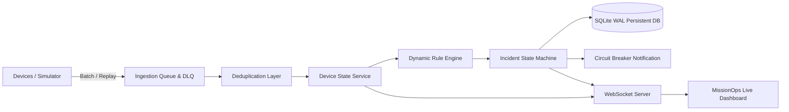

# Real-Time Operations Platform (MissionOps)

[](#running-the-automated-tests)
[](#prerequisites)
[](docs/ARCHITECTURE.md)

A high-performance, fault-tolerant operations platform designed to monitor distributed device fleets, process high-velocity telemetry bursts, evaluate dynamic operational policies, and dispatch deduplicated incidents in real time.

---

## Highlights & Implemented Requirements

- **Device & Event Ingestion**: Single (`/api/events`) and batch (`/api/events/batch`) endpoints with strict schema validation.
- **Deduplication Engine**: In-memory LRU cache + persistent DB unique indexes guarantee idempotent processing of network retransmits.
- **Out-of-Order Handling**: Monotonic sequence tracking and high-water mark timestamping prevent stale state regression while retaining full telemetry history.
- **Sudden Bursts & Backpressure**: Bounded queue with micro-batching and HTTP 429 `Retry-After` protection.
- **Dead Letter Queue (DLQ)**: Quarantines malformed payloads with error logs, and provides UI controls for inspection, retrying, and discarding.
- **Dynamic Rule Engine**: Threshold comparison, silence/heartbeat watchdog, and specific fault/event type matching.
- **Incident Deduplication & Fatigue Protection**: Repeated matching events group under the active incident with an incremented `occurrence_count` and timeline history instead of creating spam duplicates.
- **Fault Tolerance & Resilience**:
  - Process restarts: State is preserved across crashes using SQLite with Write-Ahead Logging (WAL).
  - External notifications: Circuit Breaker (`CLOSED`, `OPEN`, `HALF_OPEN`) isolates webhook outages.
- **Live Operations Dashboard**: Dark-mode cyber-operations UI with real-time WebSocket push, fleet roster, live event streaming, incident command center, rule builder, and health diagnostics.
- **Lightweight Device Simulator**: Interactive in-dashboard simulation controls and standalone CLI script (`npm run simulator:scenarios`).

---

## Architecture Quick View



Detailed architecture notes, trade-offs, and scaling analysis are available in [`docs/ARCHITECTURE.md`](docs/ARCHITECTURE.md) and [`docs/DEPLOYMENT.md`](docs/DEPLOYMENT.md).

---

## Quickstart & Evaluation Guide

### 1. Prerequisites
- **Node.js**: v22.0.0 or higher
- **NPM**: v10+

### 2. Installation
Clone or navigate to the project directory and install dependencies:
```bash
npm install
npm --prefix client install
```

### 3. Run the Automated Test Suite
Run the 11 integration and resilience tests:
```bash
npm test
```
*All tests demonstrate normal behavior, duplicate rejection, out-of-order sequencing, malformed payload DLQ quarantine, rule evaluations, incident deduplication, silence watchdog detection, circuit breaker tripping, and server restart state persistence.*

---

### 4. Start the Application

Start the backend operations platform:
```bash
npm start
```
*The server will start on `http://localhost:4000` with the pre-built React operations dashboard available directly in your browser.*

Open your browser to:
👉 **`http://localhost:4000`**

*(Optional) To run the frontend in development mode with hot-reloading:*
```bash
npm run dev:client
# Open http://localhost:5173
```

---

### 5. Running the Device Simulator

You can simulate device behavior in two ways:

#### Option A: Interactive Dashboard (Recommended)
Navigate to the **Device Simulator** tab in the dashboard at `http://localhost:4000`. You can trigger any scenario with one click:
- **Normal Telemetry Event**: Dispatches clean sensor readings.
- **Duplicate Retransmit**: Verifies that the duplicate is ignored and filtered.
- **Out-of-Order Sequence**: Injects sequence #75 followed by delayed sequence #45.
- **Malformed Payload (DLQ)**: Injects an invalid payload to see it quarantined in the DLQ.
- **Reconnection Burst Replay**: Replays 15 buffered readings in batch.
- **Critical Overheat Spike**: Emits 92.4°C to trigger the High Temperature alert.
- **Critical Hardware Fault**: Emits an actuator fault event.
- **Simulate Device Silence**: Rolls back last seen time by 45s to test the watchdog.
- **Auto Fleet Simulation**: Continuously emits live telemetry across 5 fleet devices.

#### Option B: Standalone CLI Simulator
In a separate terminal, execute all scenarios automatically:
```bash
npm run simulator:scenarios
```
Or start a continuous live fleet stream:
```bash
npm run simulator
```

---

## API Reference Overview

| Endpoint | Method | Description |
| :--- | :--- | :--- |
| `/api/events` | `POST` | Ingest single event (validates, deduplicates, evaluates rules) |
| `/api/events/batch` | `POST` | Bulk ingestion for reconnected offline bursts |
| `/api/events` | `GET` | Query recent events with optional `deviceId` and `eventType` filters |
| `/api/devices` | `GET` | List registered fleet devices with online/offline statuses |
| `/api/devices/:id` | `GET` | Get detailed telemetry history and active incidents for a device |
| `/api/incidents` | `GET` | List active/historical incidents with status and severity filters |
| `/api/incidents/:id/acknowledge` | `POST` | Acknowledge incident with operator name |
| `/api/incidents/:id/resolve` | `POST` | Resolve incident with operator notes |
| `/api/rules` | `GET`, `POST` | List or dynamically create monitoring rules |
| `/api/rules/traces` | `GET` | Audit trace log explaining why rules fired or didn't fire |
| `/api/dlq` | `GET` | Inspect quarantined malformed and failed events |
| `/api/dlq/:id/retry` | `POST` | Retry a quarantined event from the DLQ |
| `/api/health` | `GET` | Health check (uptime, database status, memory, WebSocket count) |
| `/api/metrics` | `GET` | Real-time throughput, incident counters, and queue metrics |
| `/api/circuit-breaker/toggle` | `POST` | Simulate downstream notification outage for resilience testing |
| `/ws` | `WebSocket` | Real-time push stream for events, incidents, and device status |

---

## Project Structure

```
MissionOps/
├── client/                     # Operations Dashboard (React + Vite + Design System)
│   ├── src/
│   │   ├── components/         # Dashboard views (Fleet, Stream, Incidents, Rules, Health, Simulator)
│   │   ├── services/api.js     # REST client & auto-reconnecting WebSocket manager
│   │   ├── index.css           # Dark cyber-operations CSS design system
│   │   └── App.jsx             # Root application
│   └── dist/                   # Production build served directly by backend
├── data/                       # Persistent SQLite database storage (WAL mode)
├── docs/
│   ├── ARCHITECTURE.md         # Architecture notes, trade-offs, and failure guarantees
│   └── DEPLOYMENT.md           # Production Kubernetes, Kafka, and cloud scaling guide
├── server/
│   ├── db/database.js          # SQLite ACID storage with WAL mode
│   ├── engine/
│   │   ├── ruleEngine.js       # Rule evaluator & incident deduplication engine
│   │   ├── dedupCache.js       # In-memory LRU idempotency cache
│   │   └── watchdog.js         # Silence & offline detection background worker
│   ├── queue/ingestionQueue.js # Bounded queue, backpressure & DLQ router
│   ├── routes/                 # Express REST API routes
│   ├── services/               # Device, Event, Incident, Rule, DLQ, and Notification services
│   ├── ws/wsServer.js          # WebSocket streaming server with ping/pong liveness
│   ├── app.js                  # Express application setup
│   └── server.js               # Server entrypoint
├── simulator/
│   └── device_simulator.js     # Standalone CLI device simulator
├── tests/
│   ├── ingestion.test.js       # Validation, deduplication, and out-of-order tests
│   ├── rules.test.js           # Threshold, timeout, and incident deduplication tests
│   └── resilience.test.js      # Circuit breaker, process restart, and backpressure tests
├── package.json
└── README.md
```
