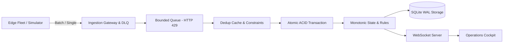

# SentinEdge

> **Autonomous Edge Fleet Telemetry & Incident Intelligence Platform**

[](#run-tests)
[](#quickstart)
[](docs/ARCHITECTURE.md)

SentinEdge is a fault-tolerant, high-throughput operations platform engineered to ingest edge device telemetry, enforce dynamic operational policies, and orchestrate deduplicated incidents in real time.

---

## Key Capabilities

* **ACID Ingestion & Idempotency**: Atomic single (`/api/events`) and batch (`/api/events/batch`) ingestion with database-level primary key constraint recovery and two-tier deduplication.
* **Route-Level Backpressure**: Bounded buffer returns `HTTP 429 Too Many Requests` with `Retry-After: 2` under heavy load to prevent event loop starvation.
* **Monotonic State Tracking**: Out-of-order sequence arrivals are logged for historical audits but suppressed from triggering false active alarms or regressing device status.
* **Self-Healing Watchdog**: Automatically resolves silence incidents the moment a device's heartbeat resumes, with anti-fatigue throttling during prolonged outages.
* **Circuit Breaker Isolation**: Isolates downstream webhook/alerting failures across `CLOSED`, `OPEN`, and `HALF_OPEN` states.
* **Dead Letter Queue (DLQ)**: Quarantines malformed payloads with UI controls for inspection and retry.
* **Operations Cockpit**: Modern, light-theme dashboard (React + Vite + WebSockets) with live telemetry waterfall, sticky headers, and gap-free reconnection resync.
* **Edge Device Simulator**: Realistic edge fleet simulation with local flash ring-buffering and burst replays.

---

## Architecture



Detailed design trade-offs and production scaling guides:
* [Architecture & Trade-offs](docs/ARCHITECTURE.md)
* [Production Deployment & Scaling](docs/DEPLOYMENT.md)

---

## Quickstart

### 1. Install & Build
```bash
npm install
npm --prefix client install
npm run build:client
```

### 2. Run Tests (17/17 passing)
```bash
npm test
```

### 3. Start the Server
```bash
npm start
```
Open **`http://localhost:4000`** in your browser.

### 4. Run Edge Fleet Simulator (Optional)
In a separate terminal:
```bash
# Continuous fleet with automatic drop & burst replay:
npm run simulator

# Or execute all validation scenarios in sequence:
npm run simulator:scenarios
```

---

## API Summary

| Method | Endpoint | Description |
| :--- | :--- | :--- |
| `POST` | `/api/events` | Ingest single event (schema validated, deduped, HTTP 429 backpressure) |
| `POST` | `/api/events/batch` | Ingest batched burst events from reconnected edge devices |
| `GET` | `/api/events` | Query recent events (supports `deviceId`, `eventType` filters) |
| `GET` | `/api/devices` | List fleet devices, connection status, and sequence numbers |
| `GET` | `/api/incidents` | List active & resolved operational incidents |
| `POST` | `/api/incidents/:id/acknowledge` | Acknowledge an incident |
| `POST` | `/api/incidents/:id/resolve` | Resolve an incident with audit notes |
| `GET` | `/api/rules` | Inspect dynamic threshold, fault, and timeout rules |
| `GET` | `/api/dlq` | View quarantined malformed payloads |
| `POST` | `/api/dlq/:id/retry` | Re-evaluate and retry a quarantined DLQ event |
| `GET` | `/api/health` | System health, uptime, and database metrics |
| `WS` | `/ws` | Real-time WebSocket event and incident push stream |

---

## License
ISC
