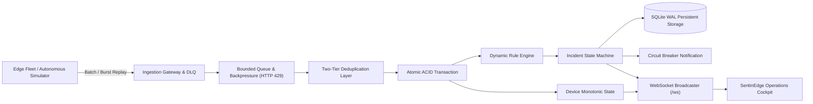

# SentinEdge — Autonomous Edge Fleet Telemetry & Incident Intelligence Platform

[](#running-the-automated-test-suite)
[](#prerequisites)
[](docs/ARCHITECTURE.md)
[](#live-operations-cockpit)
[](docs/DEPLOYMENT.md)

**SentinEdge** is a high-throughput, fault-tolerant real-time operations platform engineered to monitor distributed device fleets, process high-velocity telemetry bursts, evaluate dynamic operational policies, and orchestrate deduplicated incidents in real time.

Built to withstand hostile edge network conditions, SentinEdge provides **strict ACID transactional guarantees**, **route-level backpressure (`HTTP 429`)**, **zero-regression monotonic state tracking**, and **automatic self-healing incident resolution**.

---

## ⚡ Key Highlights & Architectural Capabilities

* **Device & Event Ingestion Pipeline**: High-performance single (`/api/events`) and batch (`/api/events/batch`) endpoints with schema normalization and validation.
* **Route-Level Backpressure (`HTTP 429`)**: Bounded queue prevents event loop starvation during massive network bursts, returning `HTTP 429 Too Many Requests` with a `Retry-After: 2` header.
* **Two-Tier Deduplication & Idempotency**: In-memory LRU cache coupled with database-level primary key constraint recovery ensures network retransmissions are absorbed idempotently without polluting the Dead Letter Queue.
* **Out-of-Order Alert Guard**: Preserves full historical time-series logs while suppressing false active alarms on stale replayed telemetry. Monotonic sequence tracking guarantees latest device state never regresses.
* **Dead Letter Queue (DLQ)**: Quarantines malformed payloads with error logs, and provides full UI controls for inspection, retrying, and discarding.
* **Dynamic Multi-Policy Rule Engine**: Evaluates metric thresholds (`> 80°C`), hardware fault event types, and silence timeout watchdogs with configurable debounce windows.
* **Incident Deduplication & Anti-Fatigue Protection**: Repeated telemetry violations automatically increment existing active incidents with timeline history instead of creating spam duplicate alerts.
* **Watchdog Self-Healing (Auto-Resolve)**: Silence watchdogs throttle repeated alerts during extended outages and automatically resolve open incidents the moment telemetry heartbeats resume.
* **Fault Tolerance & Resilience**:
  * **Zero Data Loss Across Restarts**: Guaranteed by embedded SQLite with Write-Ahead Logging (`WAL`) mode and atomic transactions (`db.transaction`).
  * **Circuit Breaker Isolation**: 3-state circuit breaker (`CLOSED`, `OPEN`, `HALF_OPEN`) isolates downstream webhook/alerting failures without blocking the ingestion thread.
* **Live Operations Cockpit**: Modern, minimalist enterprise light-mode dashboard (inspired by Stripe, Vercel, and Linear) with sub-millisecond WebSocket push, telemetry waterfall, fleet roster, incident command center, rule builder, and health diagnostics.
* **Resilient Gap-Free Reconnection**: Frontend WebSocket client automatically patches missing telemetry gaps upon reconnecting without erasing active operator buffers.
* **Autonomous Edge Simulator**: Features realistic edge nodes equipped with local flash ring-buffering that accumulate readings during disconnections and replay bursts upon link restoration.

---

## 🏛️ Architecture Overview



Detailed architectural designs, trade-off analyses, and production scaling specifications are available in:
* 📄 [`docs/ARCHITECTURE.md`](docs/ARCHITECTURE.md) — Architecture notes, ACID transactional pipeline, and failure guarantees.
* 📄 [`docs/DEPLOYMENT.md`](docs/DEPLOYMENT.md) — Production Kubernetes, Kafka, TimescaleDB, and cloud scaling guide.

---

## 🚀 Quickstart & Evaluation Guide

### 1. Prerequisites
* **Node.js**: v22.0.0 or higher (supports native `--experimental-sqlite`)
* **NPM**: v10+

### 2. Installation
Clone or navigate to the repository, install root and client dependencies, and build the frontend:
```bash
npm install
npm --prefix client install
npm run build:client
```

---

### 3. Running the Automated Test Suite

Run the complete 17-test integration, rule engine, and resilience suite:
```bash
npm test
```

#### What the Test Suite Verifies:
1. **Event Ingestion & Monotonic Sequences**: Auto-provisions devices and verifies monotonic sequence advancement.
2. **Duplicate Absorption & Idempotency**: Bypasses in-memory cache directly into database constraints to prove duplicate retries do not trigger 500 errors or pollute the DLQ.
3. **Out-of-Order Alert Suppression**: Delivers historical replayed telemetry and proves active rule evaluation is suppressed for stale sequence numbers.
4. **Malformed Payload DLQ Routing**: Rejects invalid payloads with HTTP 400 and quarantines them into the Dead Letter Queue.
5. **Route-Level Backpressure (`HTTP 429`)**: Proves that saturation triggers HTTP 429 with `Retry-After: 2` headers on `/api/events`.
6. **ACID Transaction Rollback**: Injects mid-process exceptions and proves that device state and event tables rollback completely without partial leakage.
7. **Circuit Breaker Tripping & Buffering**: Trips circuit to `OPEN` on downstream outages and buffers alerts safely.
8. **Process Crash Persistence**: Verifies complete state survival across process termination via SQLite WAL.
9. **Incident Grouping & Alert Fatigue Protection**: Proves repeated spikes increment occurrence count rather than creating duplicate incidents.
10. **Watchdog Anti-Fatigue Throttling**: Verifies prolonged silence does not bloat incident timelines.
11. **Auto-Resolve Self-Healing**: Restores device heartbeats and proves the watchdog automatically resolves open silence incidents.

---

### 4. Starting the Application

Launch the unified SentinEdge server:
```bash
npm start
```
*The platform initializes on `http://localhost:4000` with the embedded React operations cockpit served directly from the backend.*

Open your browser to:
👉 **`http://localhost:4000`**

*(Optional: To run the frontend in development mode with hot-reloading)*:
```bash
npm run dev:client
# Open http://localhost:5173
```

---

### 5. Running the Device Simulator

You can demonstrate edge behavior in two ways:

#### Option A: Interactive Web Cockpit (Recommended for Visual Demos)
Navigate to the **Device Simulator** tab in the dashboard at `http://localhost:4000`:
* **Normal Telemetry**: Emits clean sensor frames across active devices.
* **Duplicate Retransmit**: Resends identical event IDs to verify zero duplicate incidents.
* **Out-of-Order Sequence**: Injects sequence #75 followed by delayed sequence #45 to demonstrate stale alert filtering.
* **Malformed Payload**: Injects corrupted data and inspects quarantine in the DLQ tab.
* **Reconnection Burst Replay**: Replays 15 buffered readings in a single batch to demonstrate burst processing.
* **Critical Overheat Spike**: Dispatches 93.5°C to trigger the High Temperature alert policy.
* **Hardware Fault**: Dispatches an actuator hydraulic failure event.
* **Simulate Device Silence**: Rolls back last seen time by 45s to trigger the watchdog.
* **Continuous Fleet**: Toggles live continuous fleet streaming directly in the UI.

#### Option B: Autonomous Edge CLI Simulator
In a separate terminal, run the standalone simulator:

**1. Automated Verification of All Scenarios**:
```bash
npm run simulator:scenarios
```
*Executes duplicate retransmission, out-of-order sequencing, offline flash buffering with batch burst replay, malformed DLQ quarantine, overheat alerts, and hardware fault alarms in sequence.*

**2. Continuous Autonomous Fleet Simulation**:
```bash
npm run simulator
```
*Spins up a 5-device distributed fleet with automated flash ring buffering. At cycle #5, it disconnects Device 1, accumulates telemetry locally in edge flash memory, and at cycle #9 reconnects and flushes the entire buffered burst via `/api/events/batch`.*

**3. Run Individual Scenarios On Demand**:
```bash
node simulator/device_simulator.js --scenario=burst
node simulator/device_simulator.js --scenario=duplicate
node simulator/device_simulator.js --scenario=out-of-order
node simulator/device_simulator.js --scenario=overheat
node simulator/device_simulator.js --scenario=fault
node simulator/device_simulator.js --scenario=malformed
```

---

## 🖥️ Operations Cockpit Overview

The user interface follows a modern, high-density enterprise standard (inspired by Stripe, Vercel, and Linear) with clean light typography, crisp white surface cards, and no distracting neon glows:

* **Executive Metrics Grid**: Real-time counters for Fleet Health (Online/Total), Ingested Events, Active Incidents (Critical vs. Resolved), Ingestion Queue latency & depth, DLQ count, and Circuit Breaker state.
* **Fleet Operations Roster**: Live device inventory tracking connection status, last sequence number, heartbeat timestamp, and site location with one-click drilldown inspection.
* **Live Telemetry Waterfall**: Real-time event waterfall with sticky table header, alternating rows, color-coded anomaly highlights (fault, out-of-order, dedup), search by device ID, event type filtering, stream freeze/resume, and raw JSON payload modal.
* **Incident Command Center**: Dynamic incident triage table with automated deduplication and occurrence counting. Operators can inspect event details, acknowledge incidents, or mark them resolved with audit notes.
* **Rule Engine Manager**: Rule catalog for threshold, fault, and timeout policies, complete with an interactive rule creator and an evaluation trace auditor.
* **Health & DLQ Center**: Diagnostics dashboard for server uptime, database WAL metrics, circuit breaker failure injection, and quarantined DLQ payload review/retry.
* **Simulator Control Station**: One-click scenario dispatch station to trigger edge conditions and watch the platform respond in real time.

---

## 📡 API Reference Overview

| Endpoint | Method | Description |
| :--- | :--- | :--- |
| `/api/events` | `POST` | Ingest single event with schema validation, dedup, and rule evaluation. Enforces HTTP 429 backpressure. |
| `/api/events/batch` | `POST` | Ingest batched events from reconnected edge devices replaying offline flash buffers. |
| `/api/events` | `GET` | Query recent events with optional `deviceId` and `eventType` filtering. |
| `/api/devices` | `GET` | List registered fleet devices with online/offline status, sequence numbers, and total event counts. |
| `/api/devices/:id` | `GET` | Retrieve device telemetry history and active incidents. |
| `/api/incidents` | `GET` | List operational incidents with status and severity filters. |
| `/api/incidents/:id/acknowledge` | `POST` | Acknowledge incident with operator name. |
| `/api/incidents/:id/resolve` | `POST` | Manually resolve incident with resolution audit notes. |
| `/api/rules` | `GET`, `POST` | Inspect or dynamically create threshold, fault, or silence monitoring rules. |
| `/api/rules/traces` | `GET` | Audit decision trace log explaining why rules matched or skipped an event. |
| `/api/dlq` | `GET` | Inspect quarantined malformed and failed events. |
| `/api/dlq/:id/retry` | `POST` | Re-evaluate and retry a quarantined event from the DLQ. |
| `/api/health` | `GET` | Health check endpoint returning uptime, database status, memory usage, and WebSocket client count. |
| `/api/metrics` | `GET` | Ingestion throughput, queue depth, average latency, and incident counters. |
| `/api/circuit-breaker/toggle` | `POST` | Simulate downstream notification webhook outages for resilience testing. |
| `/ws` | `WebSocket` | Real-time push stream with 15s keepalive ping/pong for live event and incident distribution. |

---

## 📂 Project Structure

```
SentinEdge/
├── client/                     # Operations Cockpit (React + Vite + Enterprise Light Design System)
│   ├── src/
│   │   ├── components/         # Cockpit views (Fleet, Waterfall, Incidents, Rules, Health, Simulator)
│   │   ├── services/api.js     # REST client & auto-reconnecting WebSocket manager with gap resync
│   │   ├── index.css           # Enterprise light/neutral design system (Stripe/Linear inspired)
│   │   └── App.jsx             # Root application with state regression guards & cursor reconciliation
│   └── dist/                   # Production build served directly by backend
├── data/                       # Persistent SQLite database storage (WAL mode)
├── docs/
│   ├── ARCHITECTURE.md         # Architecture notes, ACID transactions, and trade-off analysis
│   └── DEPLOYMENT.md           # Production Kubernetes, Kafka, and TimescaleDB scaling guide
├── server/
│   ├── db/database.js          # SQLite ACID storage with WAL mode & universal transaction wrapper
│   ├── engine/
│   │   ├── ruleEngine.js       # Dynamic multi-policy evaluator & incident deduplication engine
│   │   ├── dedupCache.js       # Two-tier in-memory LRU idempotency cache
│   │   └── watchdog.js         # Silence watchdog with anti-fatigue throttling & auto-resolve healing
│   ├── queue/ingestionQueue.js # Bounded queue, capacity backpressure (429) & DLQ router
│   ├── routes/                 # Express REST API routes with route-level backpressure
│   ├── services/               # Device, Event, Incident, Rule, DLQ, and Notification services
│   ├── ws/wsServer.js          # WebSocket streaming server with ping/pong liveness
│   ├── app.js                  # Express application setup
│   └── server.js               # Server entrypoint
├── simulator/
│   └── device_simulator.js     # Autonomous edge device simulator with local flash ring buffer
├── tests/
│   ├── ingestion.test.js       # Schema, deduplication, constraint recovery, 429 backpressure & ACID rollback tests
│   ├── rules.test.js           # Threshold, timeout, incident deduplication, throttle & auto-resolve tests
│   └── resilience.test.js      # Circuit breaker, process restart persistence, and queue capacity tests
├── package.json
└── README.md
```

---

## ⚖️ License
ISC License. Built for resilient, real-time edge fleet operations.
