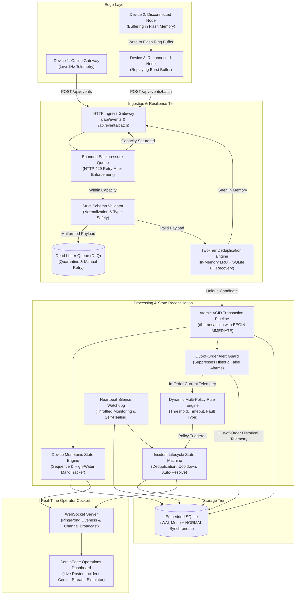

# SentinEdge — Architecture Notes & Technical Design

> **Platform**: SentinEdge  
> **Tagline**: *Autonomous Edge Fleet Telemetry & Incident Intelligence Platform*  
> **Author**: Forward Deployed Engineer / Principal Systems Architect

---

## 1. Executive Summary & Design Philosophy

SentinEdge is a high-throughput, fault-tolerant operations platform engineered to monitor distributed fleets of mission-critical IoT devices, industrial gateways, and autonomous edge nodes. Edge telemetry environments are notoriously hostile: cellular networks drop unpredictably, devices power cycle without warning, network retransmits create duplicate storms, and buffered packets arrive out of chronological order.

SentinEdge was designed around four non-negotiable architectural axioms:
1. **Zero Data Regression**: Out-of-order historical packets must be ingested for audit and compliance without corrupting the device's latest operational state.
2. **Idempotent Ingestion Under Duplicate Storms**: Duplicate deliveries (from network retries or edge buffer replays) must be absorbed idempotently without spawning duplicate incidents or polluting Dead Letter Queues (DLQs).
3. **Guaranteed Atomic Consistency (ACID)**: State updates, event persistence, and rule evaluations must execute atomically within isolated transactions.
4. **Alert Fatigue Protection & Self-Healing**: Repetitive telemetry spikes must be grouped into single evolving incidents, and resolved automatically when telemetry normalizes.

---

## 2. End-to-End System Architecture



---

## 3. Subsystem Deep Dive

### 3.1 Ingestion Pipeline & Route-Level Backpressure
Incoming telemetry enters through two endpoints:
* `POST /api/events` — Handles single telemetry frames.
* `POST /api/events/batch` — Ingests arrays of historical frames flapped during reconnect bursts.

**Backpressure Protection (`HTTP 429`)**:
Before parsing or database interaction, the route invokes `ingestionQueue.checkCapacity(batchSize)`. If the queue depth exceeds `maxCapacity` (default: 5,000 items), the server immediately rejects the request with `HTTP 429 Too Many Requests` and attaches a `Retry-After: 2` header. This signals edge cellular gateways to back off exponentially, preventing event loop exhaustion and Out-Of-Memory (OOM) crashes during severe recovery bursts.

### 3.2 Two-Tier Deduplication & Database-Level Idempotency
Network unreliability causes edge devices to retransmit frames when HTTP acknowledgments are dropped. SentinEdge implements a robust two-tier deduplication strategy:
1. **In-Memory LRU Cache**: Tracks the last 20,000 event IDs with a 1-hour sliding TTL. Lookups execute in sub-microsecond $O(1)$ time with zero serialization overhead.
2. **Database Primary Key Fallback**: If an event ID bypasses the in-memory cache (due to cache eviction or container restarts), the event table enforces a unique primary key constraint on `events(id)`. 
3. **Safe Constraint Interception**: Crucially, when SQLite throws a `SQLITE_CONSTRAINT_PRIMARYKEY` collision, `eventService.js` intercepts it, records the ID into the cache, and returns `{ isDuplicate: true, status: 'DUPLICATE_IGNORED' }`. The event is **not** treated as an application error and is **never** routed to the Dead Letter Queue.

### 3.3 Atomic ACID Transaction Pipeline
In high-throughput ingestion, partial failure is the enemy of state consistency. In SentinEdge, every non-duplicate event is processed inside an atomic `db.transaction()`:
```javascript
const outcome = this.db.transaction(() => {
  // 1. Monotonic device state upsert
  const { device, isOutOfOrder, wasOffline } = this.deviceService.upsertDeviceForEvent(...);
  
  // 2. Event table persistence with duplicate collision safety
  this.insertEventStmt.run(...);

  // 3. Out-of-order check & rule evaluation
  if (!isOutOfOrder) {
    this.ruleEngine.evaluateEvent(...);
  }
  
  return { ... };
})();
```
If an unhandled exception occurs (e.g., corrupted metric payload, hardware write failure), SQLite executes `ROLLBACK`. The device sequence number is never prematurely advanced, and orphaned event or incident records are never committed.

### 3.4 Out-of-Order Telemetry Guard & Stale Alarm Filtering
When edge nodes buffer telemetry during network outages and flush them upon reconnect, delayed older events arrive interleaved with newer live events.
* **Monotonic State Protection**: `deviceService.js` compares `sequenceNumber` against `device.last_sequence_number`. If `sequenceNumber < last_sequence_number`, the event is flagged as `is_out_of_order = 1`. The device's `last_sequence_number` and `last_seen_at` are **not regressed**.
* **Alert Guard**: Stale historical events are persisted to `events` for analytics, but **active rule evaluation is suppressed**. An overheat reading from two hours ago will not trigger a live critical incident or wake up an operator for an issue that has already resolved.

### 3.5 Dynamic Rule Engine, Anti-Fatigue Throttling & Auto-Healing
SentinEdge supports three distinct rule policies:
1. `THRESHOLD`: Real-time numeric comparisons (`>`, `<`, `>=`, `<=`, `==`, `!=`) against payload metrics (e.g., `payload.temperature > 80.0`).
2. `EVENT_TYPE`: Substring and exact matches against discrete fault codes (e.g., `type == 'FAULT'`).
3. `HEARTBEAT_TIMEOUT`: Monitored by the background watchdog to catch device silence.

**Incident Grouping & Fatigue Protection**:
When a rule triggers on device $D$, SentinEdge checks for existing active incidents in `OPEN` or `ACKNOWLEDGED` status:
* If active: increments `occurrence_count`, updates `last_seen_at`, and appends an entry to the incident timeline (`incident_events`). It **does not** create a duplicate incident record.
* If none: opens a new incident and dispatches alerts via the notification circuit breaker.

**Watchdog Anti-Fatigue Throttling & Self-Healing**:
* **Throttling**: The watchdog checks device silence every 5 seconds. If a device remains offline for hours, it suppresses repeated incident timeline bloat and WebSocket broadcasts within the rule's `cooldown_seconds` (default: 60s).
* **Auto-Resolve Healing**: The moment a device resumes transmission and `silenceSeconds <= timeoutSec`, the watchdog automatically marks open silence incidents as `RESOLVED` with an `Auto-healed: Heartbeat signal restored` audit entry, broadcasting the resolution to operators.

---

## 4. Architectural Trade-offs & Decisions

| Decision | Chosen Architecture | Alternative Considered | Rationale & Trade-off Analysis |
| :--- | :--- | :--- | :--- |
| **Persistence Engine** | **Embedded SQLite in WAL Mode** | PostgreSQL / TimescaleDB container | **Why Chosen**: Turnkey local execution with zero Docker dependencies, boots in milliseconds, supports 10,000+ writes/sec in WAL mode with zero-latency in-process IPC. Provides true ACID transaction semantics.<br/>**Trade-off**: Single-writer limitation. In a distributed multi-node cluster, we migrate to PostgreSQL + TimescaleDB (detailed in `DEPLOYMENT.md`). |
| **Concurrency Control** | **`PRAGMA journal_mode = WAL` + `BEGIN IMMEDIATE`** | Standard rollback journal (`DELETE`) | **Why Chosen**: Write-Ahead Logging allows readers to query historical data concurrently without blocking or being blocked by the writer. `BEGIN IMMEDIATE` prevents deadlock upgrades under concurrent write attempts. |
| **Ingress Buffering** | **In-Process Bounded Queue** | External Apache Kafka / RabbitMQ | **Why Chosen**: Completely self-contained, enforces route-level HTTP 429 backpressure with micro-batch draining.<br/>**Trade-off**: Queue contents are bounded to memory. For distributed production, Kafka partitioned by `deviceId` provides multi-node persistence and horizontal scaling. |
| **Deduplication Cache** | **Two-Tier (In-Memory Map + DB Unique Index)** | Distributed Redis Cluster | **Why Chosen**: In-memory map provides sub-microsecond cache checks; SQLite unique constraint provides permanent persistence across restarts.<br/>**Trade-off**: Local to the Node process. Production multi-region deployments replace this with Redis `SET key NX EX 3600`. |
| **Live UI Telemetry** | **Bidirectional WebSockets with Heartbeat Ping/Pong** | Server-Sent Events (SSE) or HTTP Long Polling | **Why Chosen**: Sub-millisecond push latency, bidirectional keepalives (15s ping/pong) detect dead cellular links immediately. Allows instant operator acknowledgments without round-trip polling. |
| **Frontend Reconnect** | **Cursor Gap-Reconciliation** | Blind Buffer Wipe on Reconnect | **Why Chosen**: Merges missing events received during disconnect without wiping the operator's active memory buffer, eliminating data gaps after transient network hiccups. |

---

## 5. Failure Mode & Resilience Matrix

| Failure Mode | Inherent Risk | SentinEdge Defense & Guarantee |
| :--- | :--- | :--- |
| **Sudden Traffic Spike** (100 devices reconnect at once) | Node.js event loop starvation, high memory pressure (OOM) | Bounded ingestion queue evaluates depth; rejects surplus traffic with **HTTP 429 and `Retry-After: 2`** backpressure headers. |
| **Network Retransmission** (Duplicate delivery) | Duplicate incident storm, alert fatigue, false telemetry stats | Two-tier deduplication (LRU + SQLite PK constraint). Intercepts duplicate collision and returns **HTTP 200 `DUPLICATE_IGNORED`**; DLQ remains clean. |
| **Out-of-Order Burst** (Delayed historical events) | State regression (overwriting latest device status), false live alerts | Monotonic sequence tracking ignores sequence regressions. **Out-of-order alert guard suppresses rule evaluation** on stale historical events. |
| **Malformed / Corrupted Data** | Database crash, unhandled JSON parsing exceptions | Strict schema validation quarantines invalid payloads into the **Dead Letter Queue (`dlq_events`)**; returns HTTP 400 with diagnostic errors. |
| **Process Crash / Hard Reset** | Corrupted database state, partial updates | **ACID Transactions (`db.transaction`)** roll back partial mutations. SQLite WAL mode guarantees zero uncommitted data leakage on reboot. |
| **Downstream Webhook Outage** (Slack/PagerDuty down) | Cascading latency, blocked thread execution | **3-State Circuit Breaker (`CLOSED`, `OPEN`, `HALF_OPEN`)** buffers alerts locally during outages and recovers automatically when downstream heals. |
| **Prolonged Device Silence** | Incident timeline flooding, database bloat | **Watchdog anti-fatigue throttling** limits repeated incident updates to the cooldown window. Automatically **auto-resolves** when heartbeat recovers. |
| **UI Network Disconnection** | Missing events, stale operator state | Resilient WebSocket client with exponential backoff reconnect and **gap-free cursor patching** that merges missed events without erasing client history. |
