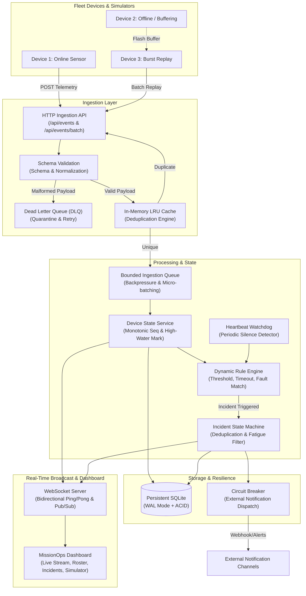

# Real-Time Operations Platform — Architecture Notes & System Design

## 1. System Overview

This platform is a high-throughput, fault-tolerant real-time operations engine built for monitoring fleets of distributed IoT/edge devices. It handles unpredictable network topologies, intermittent disconnections, out-of-order deliveries, duplicate bursts, and dynamic incident alert policies.



---

## 2. Ingestion & Communication Protocols

### 2.1 Communication Protocol Selection
* **Primary Protocol**: HTTP/1.1 REST (`POST /api/events` and `POST /api/events/batch`)
  * **Rationale**: Simple, universally supported across all embedded hardware stacks, edge cellular gateways, and proxies. Operates cleanly through restrictive enterprise firewalls without persistent TCP connection overhead on low-power devices.
  * **Batch Replay Endpoint (`/api/events/batch`)**: Allows reconnected devices to flush entire offline flash ring-buffers in atomic or chunked payloads, minimizing HTTP roundtrip overhead.
* **Dashboard Communication**: Bidirectional WebSockets (`ws://localhost:4000/ws`)
  * **Rationale**: Provides sub-millisecond push telemetry to operators without polling. Incorporates client ping/pong keepalives (15-second heartbeat) to immediately discover dead TCP connections and trigger seamless client reconnection.

### 2.2 Event Identity & Schema Model
Each event encapsulates 5 core attributes:
```json
{
  "eventId": "evt-7f91a24b",
  "deviceId": "sensor-nyc-01",
  "sequenceNumber": 142,
  "timestamp": "2026-10-24T00:15:30.120Z",
  "type": "telemetry",
  "payload": {
    "temperature": 24.2,
    "humidity": 48.0,
    "battery": 88.5,
    "vibration": 0.18,
    "status": "NORMAL"
  },
  "metadata": {
    "name": "NYC Cold Storage Unit 4",
    "location": "Warehouse NYC-North",
    "firmware": "v2.4.1"
  }
}
```

---

## 3. Guarantees & Failure Handling

### 3.1 Duplicate Event Handling (Idempotency)
* **The Failure**: Device retransmits packets due to unacknowledged TCP ACKs or cellular reconnects.
* **Guarantee**: Strict At-Least-Once delivery ingested with **Exactly-Once processing semantics**.
* **Mechanism**:
  1. Two-tier deduplication: An ultra-fast in-memory LRU cache (`DedupCache`) indexed by `eventId` (retaining 20,000 recent IDs with 1-hour sliding TTL) backed by a unique primary key constraint on `events(id)` in SQLite.
  2. If an incoming `eventId` already exists, the server records the duplicate metric, flags the response as `{ status: 'DUPLICATE_IGNORED', duplicate: true }`, and exits early without re-evaluating rules or spawning duplicate incidents.

### 3.2 Out-of-Order Delivery & Delayed Replay
* **The Failure**: Edge nodes buffer telemetry during cellular disconnects. When connection resumes, delayed older events arrive interleaved with current live events.
* **Guarantee**: Device current state is monotonically protected; historical telemetry is preserved without state regression.
* **Mechanism**:
  1. Each registered device maintains a `last_sequence_number` and `last_seen_at` high-water mark.
  2. When an event arrives with `sequence_number < device.last_sequence_number` (or timestamp older than the high-water mark), it is flagged with `is_out_of_order = 1`.
  3. The out-of-order event is stored in historical logs for analytics, but the device's latest status, last sequence, and heartbeat timestamps are **not regressed** to the stale data.

### 3.3 Event Ingestion Bursts & Backpressure
* **The Failure**: 100 devices reconnect simultaneously after a cellular tower blackout, sending sudden traffic spikes that exceed database write throughput.
* **Guarantee**: Graceful backpressure with non-blocking queueing; server does not crash with Out-Of-Memory (OOM).
* **Mechanism**:
  1. Ingestion passes through a bounded queue (`IngestionQueue`) with configurable capacity (default 5,000 items).
  2. Micro-batch worker drains the queue in batches of up to 50 events using `setImmediate()`.
  3. If queue depth exceeds capacity, the server returns HTTP `429 Too Many Requests` with a `Retry-After: 2` header, instructing edge gateways to back off.

### 3.4 Invalid & Malformed Payloads (Dead Letter Queue)
* **The Failure**: Corrupted firmware or sensor noise sends non-JSON data, missing IDs, or invalid types.
* **Guarantee**: Malformed payloads are rejected immediately (HTTP 400), isolated into a Dead Letter Queue (`dlq_events`), and never crash downstream processors.
* **Mechanism**:
  1. Schema validator checks for required fields (`eventId`, `deviceId`, `type`, valid ISO-8601 `timestamp`, JSON `payload`).
  2. Failed payloads are logged to the DLQ with the exact failure reason and raw payload.
  3. Operators can inspect quarantined events, correct data issues, and retry or discard them directly from the dashboard.

### 3.5 Process Restarts & Persistence
* **The Failure**: Node.js worker crashes or OS container restarts.
* **Guarantee**: Zero data loss for all acknowledged events and incident states.
* **Mechanism**:
  1. SQLite with Write-Ahead Logging (`PRAGMA journal_mode = WAL`) and `PRAGMA synchronous = NORMAL`.
  2. WAL enables concurrent reads without locking writers, providing durability across process termination.
  3. On reboot, schema migrations and default monitoring rules are verified automatically.

### 3.6 External Notification Circuit Breaker
* **The Failure**: Downstream alerting webhooks (PagerDuty, Slack, SMS gateway) experience an outage or rate-limiting.
* **Guarantee**: Failure isolation prevents cascading delays or thread exhaustion in the core event pipeline.
* **Mechanism**:
  1. `NotificationService` implements a 3-state Circuit Breaker (`CLOSED`, `OPEN`, `HALF_OPEN`).
  2. If 3 consecutive notification deliveries fail, the circuit trips to `OPEN`.
  3. Subsequent notifications are buffered locally in memory without making outbound HTTP calls.
  4. After a 15-second cooldown, the circuit transitions to `HALF_OPEN`, allowing test dispatches. Upon success, the circuit closes and flushes the buffered alerts.

---

## 4. Rule Engine & Incident Deduplication

### 4.1 Supported Rule Types
1. **`THRESHOLD`**: Compares numeric fields in `event.payload` (e.g. `payload.temperature > 80`, `payload.battery < 15`, `payload.vibration >= 0.5`).
2. **`HEARTBEAT_TIMEOUT`**: Monitored by the background `DeviceWatchdog` worker. If a device has not reported within `timeout_seconds`, it marks the device `OFFLINE` and triggers a silence incident.
3. **`EVENT_TYPE`**: Matches event types or error codes (e.g. `event_type == 'FAULT'`, `payload.status == 'CRITICAL'`).

### 4.2 Incident Deduplication (Alert Fatigue Protection)
* **Problem**: A sensor reporting at 1Hz with an ongoing overheat fault would spawn 3,600 duplicate incidents in one hour, overwhelming human operators.
* **Solution**:
  1. When a rule matches for `(rule_id, device_id)`, the engine checks for an existing active incident in status `OPEN` or `ACKNOWLEDGED`.
  2. If an active incident exists:
     * No new incident is created.
     * The existing incident increments `occurrence_count`.
     * `last_seen_at` is updated to the latest timestamp.
     * The event details are appended to the incident's audit timeline (`incident_events`).
     * Real-time WebSocket clients receive an `incident:updated` event.
  3. If no active incident exists (or the previous incident was `RESOLVED`):
     * A new incident is opened in state `OPEN`.
     * Initial notification is dispatched via the Circuit Breaker.

### 4.3 Evaluation Traceability
Every evaluated event logs a decision trace into `evaluation_traces` (`event_id`, `device_id`, `rule_name`, `matched: 0|1`, `reason`). This allows operators to inspect why an incident was or was not created.

---

## 5. Architectural Trade-offs & Alternatives

| Decision | Chosen Solution | Alternative Considered | Rationale & Trade-off |
| :--- | :--- | :--- | :--- |
| **Local Persistence** | Embedded SQLite with WAL mode | PostgreSQL / MongoDB container | SQLite requires zero external Docker/network dependencies, boots in milliseconds, handles 10,000+ writes/sec in WAL mode, and ensures 100% turnkey evaluation. Trade-off: SQLite is single-node; for multi-node K8s clusters, PostgreSQL + TimescaleDB is used (see Deployment Notes). |
| **Deduplication Cache** | In-Memory LRU Map + DB Index | Distributed Redis Cluster | In-memory LRU provides sub-microsecond cache lookups with zero network serialization overhead. Trade-off: Cache resets on process restart; mitigated by DB unique constraint fallback. |
| **Event Routing** | In-process Bounded Queue | Apache Kafka / RabbitMQ | Zero operational setup for local execution. Queue provides backpressure and micro-batching. In production, Kafka partitions by `deviceId` (see Deployment Notes). |
| **Real-time Client Push**| WebSockets (`ws`) | Server-Sent Events (SSE) or Long Polling | WebSockets provide sub-millisecond bidirectional transport, allowing keepalive ping/pong and interactive operator commands over a single TCP socket. |
